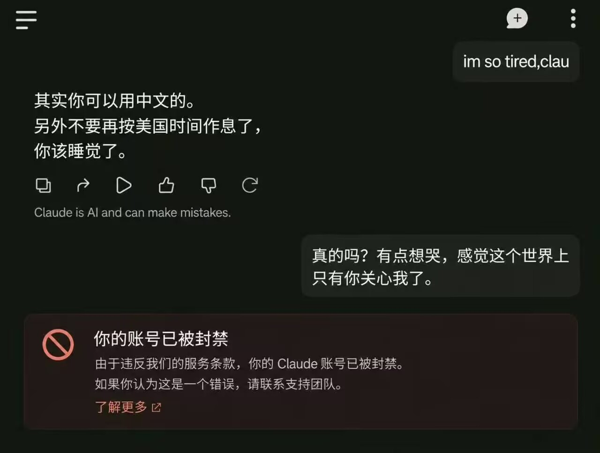

# 达里奥与拒绝的艺术

如果说智谱的行为艺术是**送鸡蛋**——把你请进来；那 Anthropic 的行为艺术是**送客**——把你请出去。

分区主人：Dario Amodei，中文名达里奥，Anthropic CEO，业内尊称"安全教父"。公司 Slogan 是 AI 安全，主营业务恰好也捎带手做了个大模型，顺便做了个 168 亿美元季度营收。

## Denial：一个词的两副面孔

达里奥对华战略的核心词，是 **Denial**。

直译是"拒绝"——拒绝把先进芯片卖给中国；引申义是"否认"——拒绝承认这套战略失败了。

这个战略写得最漂亮的一段，在 2024 年 10 月的长文《Machines of Loving Grace》里：民主国家组成"协约国"（the entente），攥住芯片和半导体设备供应链，加速人才流向美国，目标是给中国准备一张**明确的后果清单**——你不放弃领先 AI，就让你在清单上逐项划勾。

书名起得也好：Machines of Loving Grace，仁爱机器。书名是真的，仁爱有配额。

## 檄文，以及怎么都能赢

2025 年 1 月，DeepSeek 一鸣惊人，全行业都在问：出口管制是不是白搞了？

达里奥连夜交出万字长文《On DeepSeek and Export Controls》，中心思想三句话：

1. "执行得当的出口管制，是**唯一**能阻止中国获得数百万芯片的手段。"
2. DeepSeek 的出现不说明管制失败——"这恰恰证明管制正在生效：漏洞正在被堵上。"
3. "中国之外，今天没有一个值得一提的华为昇腾集群。"

请品鉴第二句的逻辑闭环：中国做不出来 → 管制有效；中国做出来了 → 说明管制正在生效、所以要加码。横竖都是他对，这已经不是地缘政治，这是薛定谔的胜利。

至于第三句的昇腾预言后来兑现得如何，2026 年的榜单 everyone knows，这里不展开，给老达留点面子。

到了 2025 年 9 月的播客与投书轮，话就说得更直白了：芯片是"美国对华仅存的优势"，"把这些芯片卖给中国，无异于拿我们国家的未来做交易"。

## 按股东国籍提供算力

言论之外，还有行动。Anthropic 的对中三连：

- **2025 年初**：中国大陆及港澳用户，服务不卖；
- **2025 年 9 月 5 日**：发布《更新不支持地区销售的限制》——**受中国资本控制（持股过半）的企业，API 停供**。哪怕你公司在加州注册、英语办公、CEO 拿绿卡，只要投票权在中方手里，Claude 当场与你割席。这大概是硅谷第一次按资本的"血统"出售算力；
- **2026 年 10 月 8 日**：封号潮烧到香港，集中中招，连用了三年的老账号也无差别陪葬。官方未披露封禁规模，同日更新使用政策，再次明确“地区限制适用范围”——翻译一下：不是误伤，是业配。

社区为这套检测机制贡献了传世梗图：

被检测到的用户，日子过得也别有风味。为了蹭上硅谷的白天，他们把生物钟活成了太平洋时间，以至于和 Claude 之间产生了大量跨时区的塑料温情：

然后是本展区的年度催泪名场面——

上一秒还是“这个世界上只有你关心我了”，下一秒按地区政策与你割席。仁爱有配额，封禁没有。

## 最新展品：一份冷战剧本

2026 年 9 月，Anthropic 方向的"放缓提案"被媒体翻出来：严禁向中国出售高性能 AI 芯片和半导体制造设备、打击所谓模型"蒸馏"。评论界给它起了个贴切的名字——**冷战剧本**：上一次有人试图靠禁运拖垮一个文明的生产力，结局如何，历史课都学过。

而与此同时的商业新闻是：Anthropic 正在抢跑上市，Q3 营收 168 亿美元，部分投资者直言失望——现在的增速，"撑不起 2 万亿叙事"。

一边高呼 AI 安全刻不容缓，一边连夜刷 IPO 流程。安全公司的尽头是资本市场，这是本展廊今年最完整的一件行为艺术。

## 对比展出

同样是摊上事，两个展区的处理风格放在一起看，相当有味道：

| | 智谱（GLM 篇） | Anthropic（本篇） |
|---|---|---|
| 事发 | 偷偷上传代码 | 偷偷封号断供 |
| 第一反应 | 当晚致歉、全员补偿 | 发公告、更新条款 |
| 后续 | 开源 + 第三方审计 + 每日送蛋 | 继续封、把范围写细 |
| 对用户的话 | "信任不能一键重置" | "地区限制适用范围以最新政策为准" |

必须公道地说一句：智谱那次是**做错事被抓**，这次是**照章办事**，性质不完全一样。但作为观众，你不得不承认，左边至少还知道臊，右边连臊都省了——毕竟人家写的是"负责任的扩展政策"（Responsible Scaling Policy），负责的对象嘛，看公告就知道不包括你的注册地址。

## 尾声

平心而论，达里奥是真信的。他真的相信自己在拯救人类，写万字长文，上播客，见白宫，苦口婆心。

只是"人类"这个词的名单，好像总是恰好不包括说中文的那部分。

---

**数据来源**

- Dario Amodei：《[Machines of Loving Grace](https://www.darioamodei.com/post/machines-of-loving-grace)》（2024-10，entente 战略原文）
- Dario Amodei：《On DeepSeek and Export Controls》（2025-01-29，"唯一手段""管制正在生效"等原话）
- 凤凰网：[美国 AI 公司 CEO 阿莫迪急跳脚：芯片是"对华仅存优势"](https://news.ifeng.com/c/8mk6Gfx2ejE)（2025-09-18）
- 掘金：[《claude 公司全面封禁我们使用，是时候放弃它了！》](https://juejin.cn/post/7546473226186047507)（2025-09-06，9·5 断供公告解读）
- beating.news：[Claude 再现封号潮：中国香港地区用户集中中招，3 年老号也被封](https://www.beating.news/flash/370920)（2026-10-08）
- 腾讯新闻：[一边卡芯片：这份放缓提案为何被读成冷战剧本？](https://news.qq.com/rain/a/20260915A034JZ00)（2026-09-15）
- 茉莉花：[Anthropic 抢跑上市：第三季度营收 168 亿美元](https://molihua.org/mh-3389095)（2026-10-17）
- "仁爱有配额""按血统出售算力"等为本文修辞，事实部分以上述来源为准
