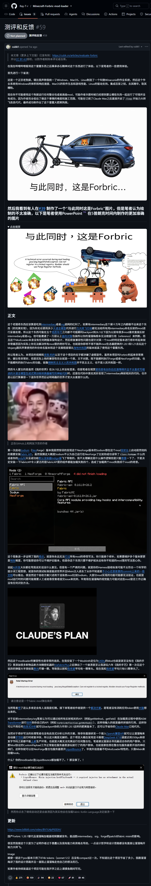
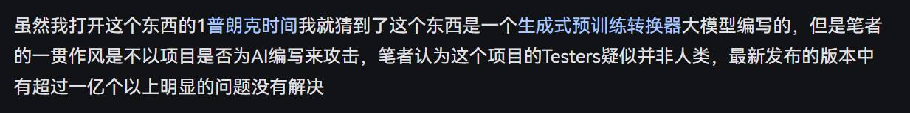
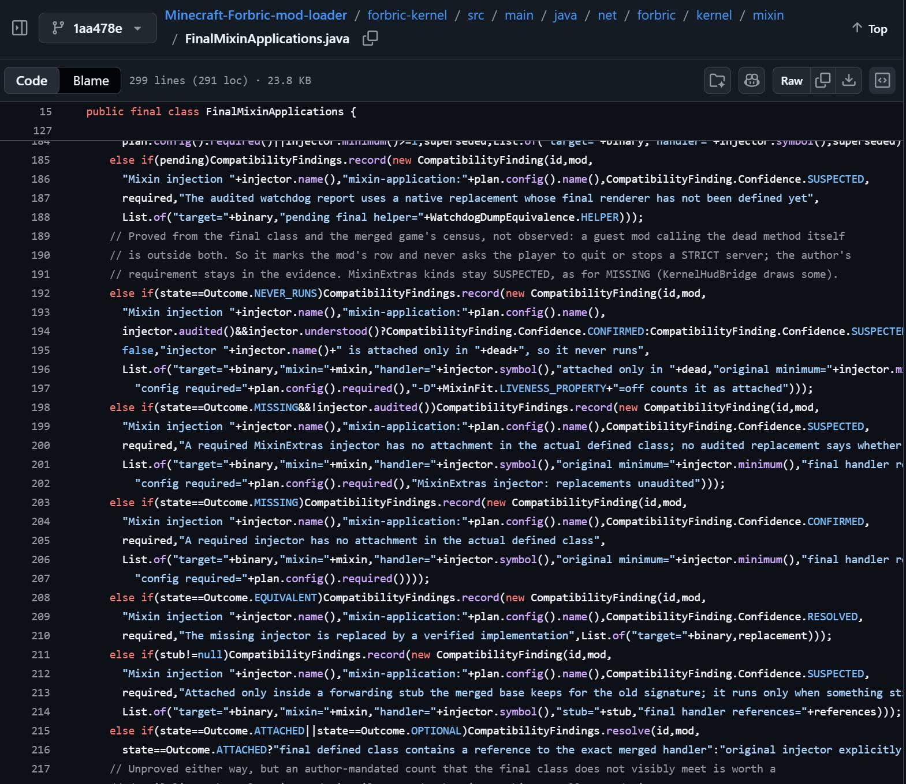
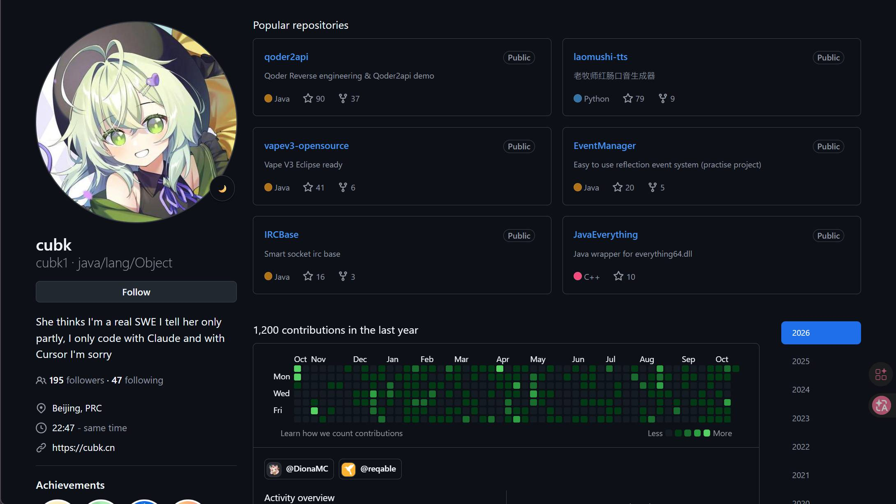
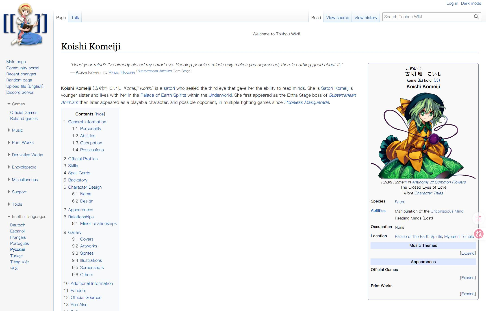

2026年10月18日，周日。我想我绝对不会忘记这篇令我狂笑15分钟不止，完全成为二傻子的issue。

很难想象大三了居然还能如此不受控制地笑，如果你感兴趣可以自行阅读这篇文档。在图片的下方，我们来分析一下，这篇issue的语言艺术高级到了何种地步，以及为何吐槽的这个项目可以荣幸至纳入“未来别来！”专题。

## 中文之神的发言

ok，我们来看一下这个文章当中存储了多少作者的设计小巧思。
## 背景
Minecraft，即我的世界，Java版本游戏游玩时若要添加模组、外部整合包，一般有两种添加方法可以选择： Forge/NeroForge 与 Fabric，只要你选择了一种方法，那么通常两种方法就不能再互通了。此时你就会面临这样一个困境，两个都很好玩的模组A与B，采用了不同的扩展方法，这导致你无法在一个存档中同时享用这两份肥美的模组，因为方法不同会引入冲突。

此时，有一个B站UP发布了一条视频，声称自己开发了一款名为 Forbric 的工具，名字就缝合了 Forge 与 Fabric，这个工具解决上面的模组冲突问题。

## 主人公登场
关于解决模组扩展方法不统一产生的冲突问题，显然在游戏界不是什么新鲜事。在MC的大部分玩家里，有相当部分玩家都是聪明的极客，他们总乐意捣鼓各种模组，解决各种问题。所以你应该发现了，这么一个极其显然的历史遗留重大痛点问题，怎么可能没人想过去解决呢？

因此结果只有一个：玩家门必定是都尝试过了，但都以失败告终。

此时，一个手握 AI coding，同时啥也不懂的小白，一下子蹦出来声称自己解决了这个千古大难题，那肯定是灾难的。而发帖人 cubk1 就开始了他的吐槽。

## 地道与新奇的用词

作为精通中文互联网表达艺术的老师傅 cubk1，对用词简直是信手拈来。同时发挥了太多原本不属于这个场景的內容，看他的用词：

- 肥美：同时形容了多种对象，无论是狗屎还是mod生态1.20.1与1.21，都证明了肥美这个词汇本身的通杀性，展示了什么叫做好词不挑对象，一词统摄所有

- 普朗克时间与地质年代：普朗克是目前根据物理定律而计算出的，现认为最小不可分时间单位，时间不是连续的。在文中当中，作者声称使用了5普朗克时间制作了一张PPT。在后面一篇锐评其他项目的issue中，作者甚至再次使用了该概念，使用了1普朗克时间认出项目的生成方。可见作者很喜欢普朗克时间。同样的，地质年代的时长也夸张说明了几乎不可能完成。

- 溜溜梅：LLM（Large Language Model-大语言模型）的中文再替换

- 读我.妈的：README.md（项目介绍文档）的中文再次直翻，并且引入一点优雅国语

- 发射台：Launcher的中文直译，其实本来它应该叫做启动器

## 藏在表象之下

不知道你是否发现，但是我阅读这篇文章的时候呢，感觉就很奇怪：这篇文章怎么这么多链接，发送一篇吐槽issue需要这么多链接吗？后来我发现，这应该是老牌艺术家的追求，一份好的抽象作品必须要是面面俱到的。

绝大部分链接我都让AI爬了一遍，是的，这些链接里面有正常的，也有不正常的。绝大部分链接都指向了wiki，但是那少部分又显得极其诡异。通过一会正经一会不正经把控叙事节奏。

少部分诡异的链接我一一给你展示：

- 力大砖飞行动：https://addyosmani.com/blog/loop-engineering/。是的，这是一篇博客，介绍 loop 工程的博客，点进去，这篇文章的作者其实是一位Google AI研究员。多轮循环，自我纠错这个概念，可以说绝对给了AI小子们太多不切实际的幻想：反正有loop自我纠错，他会帮我干好的。只要loop够多，token够多，任务就能达成。力大砖飞可谓非常贴切，尽管作者的本意并不是这样。

- 使用患有创伤后应激障碍并且不太喜欢写缩进的大语言模型生成式预训练转换器编写的神秘代码：额是的，我想你已经get到了，这段內容指向的就是 forbric 项目的一大串 Java 代码，显然都是AI生成的，并且看来真的相当缺乏可读性了。我们放一小段代码来感受一下这段艺术

- 打过：这里指向了一款我的世界作弊工具网站

- AI开发：这个你还别说，这是好东西，我头一次见https://github.com/tradecatlabs/vibe-coding-cn。这是一个中文文档vibe-coding系统教学，截至书写文档时，这个仓库有17k star。

- 不小心还是故意的commit上来一些文档：https://www.youtube.com/watch?v=gFx-NjTw3sM。这是一段说唱，主要內容是 Claude code plan 让用户离开 codex 。总体感受像一种传教洗脑感，鼓吹claude code方案多棒。而也正是本项目是使用了 claude code 开发，issue作者在讽刺项目作者不会使用 Agent 编程工具净上传一些不明所以的神秘文件

- 我老婆：是的，我在初次读这段內容时，并没有发觉什么异样，或许发issue的作者是已婚先生。那也说得过去。于是此时，你将视线移动到了作者的头像。。。看起来，这人应该不是已婚的。

接着你来到这个作者的blog界面，它是2007年生人。也就是说，比我还小一岁。那么这个老婆是谁？哦~原来如此：这个角色是“古明地 恋”，出自《东方Project》系列

于此同时，你也欣赏到了睾丸共享论的使用。事实上，在这里提及睾丸并没有任何用。无厘头的引入或者只是作者想要宽慰自己自己仅剩了与希特勒同样数量的睾丸，以及自己的“老婆”。

- NeoForge的Neo：这里指向的是Macbook Neo的售卖网站。。。

## 这个项目究竟有多诡异？

1. 命名反射机制决定了，高版本mod很难兼容处理，应当放弃。但作者选择直接抛弃高版本mod，回到低版本mod开发，然后说：嘿，我这东西是有用的，可以兼容。
2. 第一次启动NeoForge，这个程序居然想要安装 Fabric 接口。我们先前提到了，这两种方式几乎是水火不容，相互冲突的。但是这里居然要互相依赖着安装。好吧，那你装就装好了，结果是：装完了照样加载失败
3. 灾难式的验收。很显然，claude code 和 dsh 不同，dsh会给自己定非常多的测试标准。但claude不会，同时作者又是一个Agent小白，或许它根本不知道什么叫做测试，他认为的成功就是：我能成功进入游戏存档，但不管mod是否加载，他根本不在乎这些状态。根本没法掌控一个如此大型的项目。
4. 几乎无法修复，作者提到了报出了一个他六年都没见过的头个新error。六年的时间，作者和各种兼容性bug肯定做过斗争，解决过无数问题。此时出现了他都没见过的错误，你觉得小白可能有能力解决这个错误吗？
5. 没有任何架构设计，纯粹的Agent力大砖飞。论谁都不敢接手这样一个没人知道他在干什么的项目
6. 作者为了解决问题，选择直接封锁issue，拒绝沟通了

从以上所有內容来看，这真是妥妥的浪费钱。优秀的大模型在糟糕的人手里做出的东西简直是一言难尽。特别是作者本身就是小白还大言不惭声称解决了千古难题，更是让人在记恨AI小子的本子上多写上了一笔。