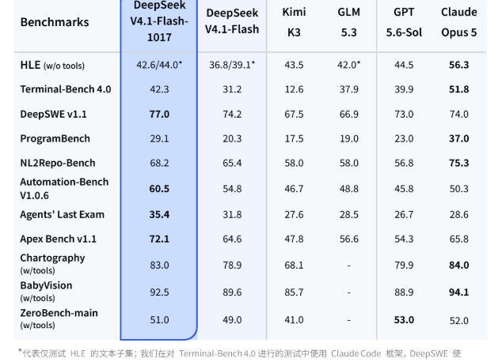
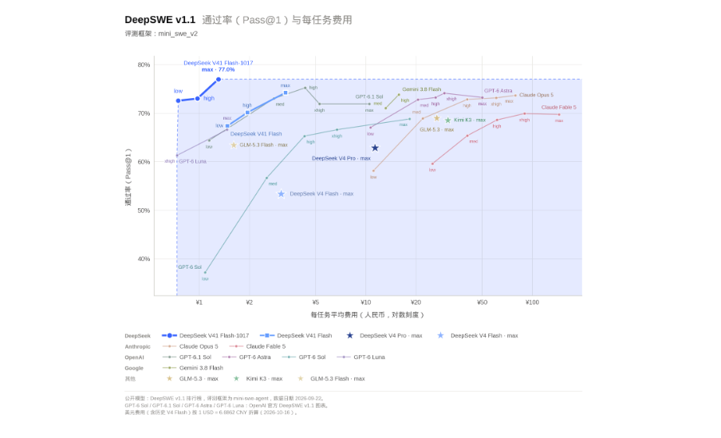
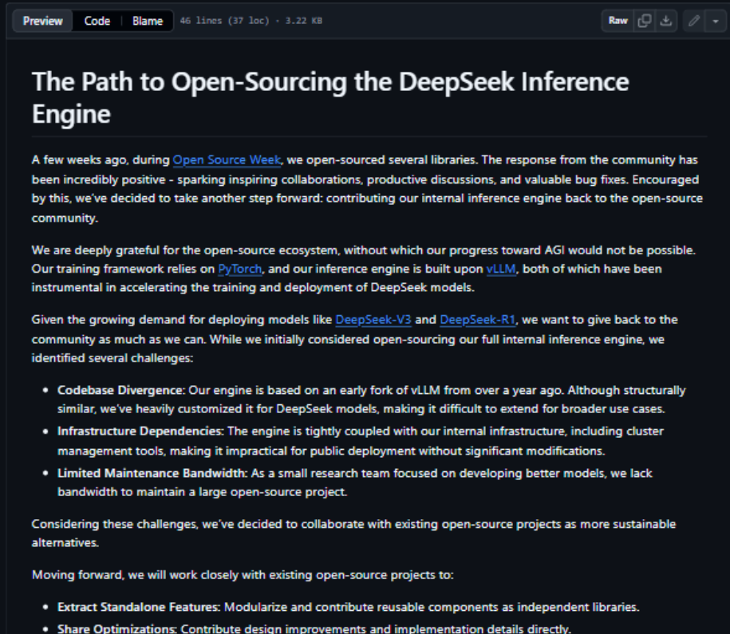
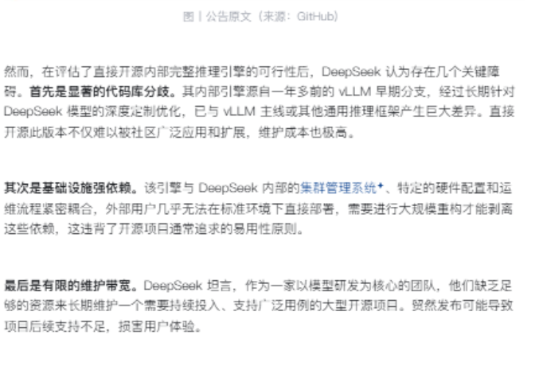
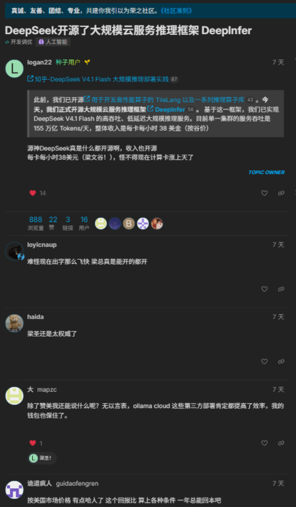
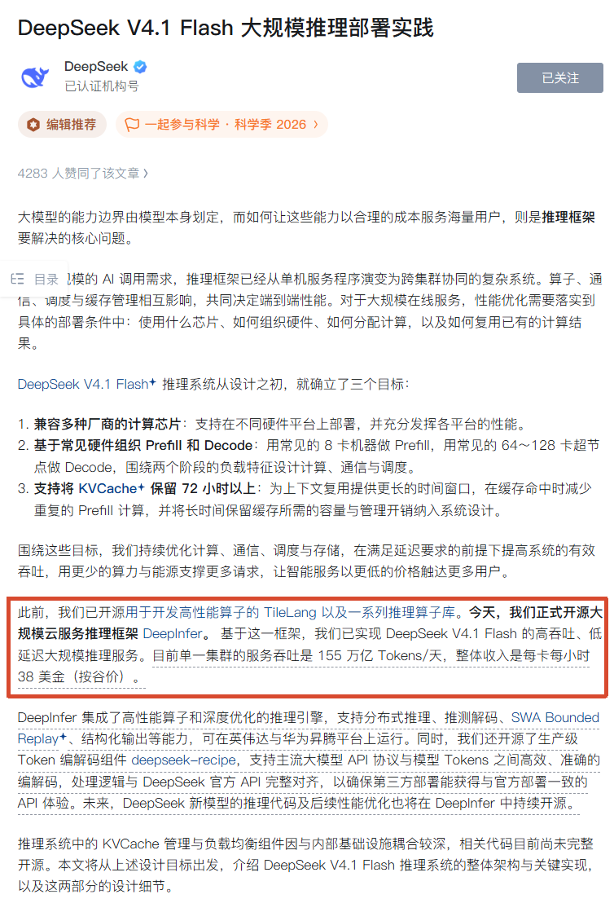
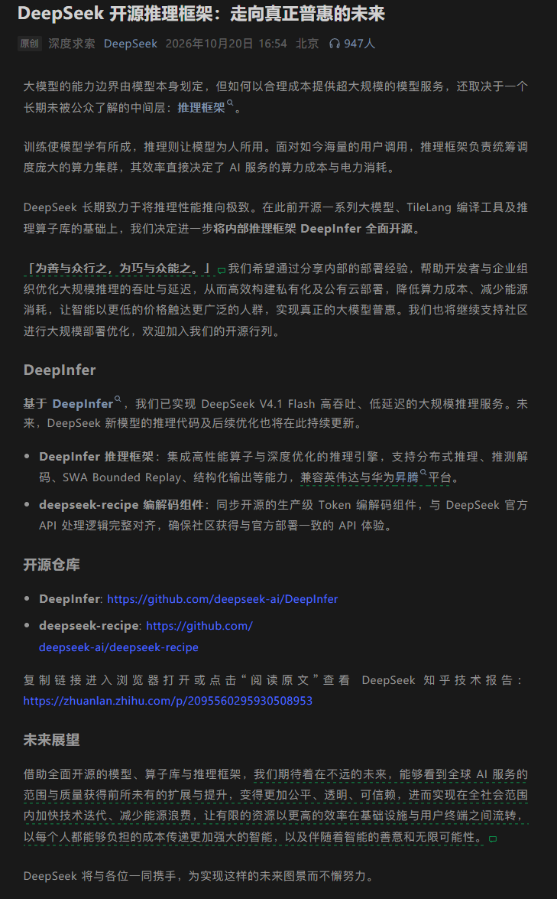
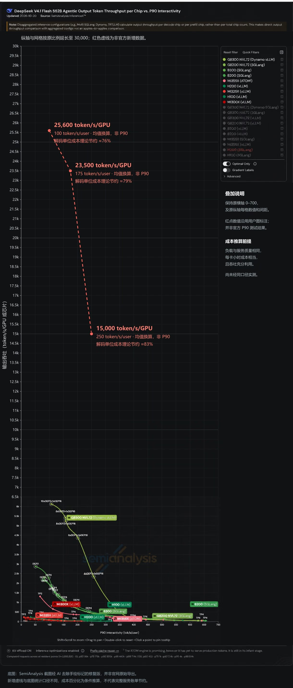

# 三天两刀：Flash-1017 与 DeepInfer

## 不鸣则已，一鸣惊人

10 月 17 日，DeepSeek 正式发布 deepseek-flash 1017

10 月 20 日，Deepseek 正式开源内部推理框架 DeepInfer 

不夸张地说，这是整个十月份最让人意外又“恐怖”的消息。

三天，两刀：第一刀砍向价格，第二刀砍向成本结构。下面按时间顺序展开。

## 一、1017：成本为王！

1017 发布时未改变`deepseek-flash` 模型名，主体仍然为 `deepseek-flash`

### 能力测评

蓝框中的黑体数字表明在该测试中，deepseek 的横向对比评分为第一，为DeepSWE v1.1、Automation-Bench、Agents' Last Exam、Apex Bench。以上几个维度都是执行维度。剩下的 HLE、NL2Repo、ProgramBench，即deepseek在横向对比中落败的，是输入能力测评。

简单等效，可以理解为模型理解能力没有提升，但执行能力大幅提升，这更加符合deepseek自我定位为Agent基座的理念。

第二张图更能展现模型执行力水平，注：横轴为"每任务平均费用"，纵轴为 DeepSWE 通过率，并且横轴为对数刻度。

- DeepSeek Flash 的两条线（上一版和 1017）都在横轴左侧，意为，DeepSWE通过率超过70%的平均每任务花费为约不到￥2。

- 同时，Astra、Opus 5、Fable 5 要达到同级通过率，成本在约 ¥30–90

价格优势一直都是 deepseek 的杀手锏。能力没变强？那降低成本就是变相增强。

### 搜索引擎 API

Deepseek 顺手开放了自研搜索引擎 API：Search 与 Fetch，价格均为 ¥5/千次。

目前通过 Server 工具调用命中这两个接口不计费，2026 年 11 月 1 日开始起按次收费。

搜索引擎API会有更强的搜索能力，在搜集资料，爬取数据等方面都能得到更强提高，再例如发出“帮我上网搜一下有没有类似的”之类的提示词下，能够更大限度满足需求。

## 二、DeepInfer：核弹来袭

10 月 20 日，两个仓库同时开源：`deepseek-ai/DeepInfer` 和 `deepseek-ai/deepseek-recipe`。

如果说 1017 是台前的降价，那 DeepInfer 就是幕后那台机器第一次掀开帘子——这是 DeepSeek 用来服务自家 API 的内部推理框架，这次连代码带部署心得，整个交了出来。

官方技术长文在知乎，链接在文末。

### 推理模型的强悍之处

Deepseek Infer 主要有三个核心设计目标：

1. 兼容计算芯片
2. 基于常见硬件组织 Prefill 和 Decode
3. KVCache 保留 72 小时以上

#### 兼容计算芯片
这样庞大的计算模型，普通人是根本没法部署的。因此，如果开源指的是面向个人用户开源，那也没有意义。好比说巨人送给矮人一张床，矮人甚至连床都跳不上去，那这就是废品。

同时，因为推理模型深度耦合计算芯片，那么开源了，别的企业也无法使用，名义上开源，性质上却是闭源的。

在去年（2025 年 4 月），DeepSeek 就公开回应过：暂时不会开放内部推理引擎的完整代码库。官方在 `open-infra-index` 仓库里给出的解释很坦诚：引擎源自一年多前的 vLLM 早期分支，经过深度定制后已与内部基础设施强耦合，外部环境难以直接部署；小团队也没有精力维护一个大型开源项目。替代方案是把可复用的组件拆出来贡献给社区（开源周的 FlashMLA、DeepEP 正是这个思路），并承诺将核心优化注入 vLLM 生态。

在那时，不少人都讥讽 deepseek 打着开源的旗号行闭源之实，认为这套说辞是给闭源找的借口。一年之后，Deepseek 针对这个问题就做了优化，此次发布，证明了他们解决了耦合问题。

兼容芯片到底有什么作用？这就回到了一开始的问题，企业如何使用这些开源模型？

在早期，推理模型和厂商自家采购的计算芯片是高度定制化适配的，这就导致，换了一种计算芯片的运行效果大幅下降，再不济就是完全无法运行。例如Deepseek基于华为昇腾芯片训练，而国外都基于Nvidia的H系列芯片训练，那么不解决耦合问题，deepseek infer 就只能在昇腾上跑。并且，厂商不可能因为一套开源模型就更换自家的全部设备，这会消耗大量资金，是不可能的。

成功解决耦合问题后，同样的推理模型，既能在昇腾上运行，也能在Nvidia上运行。这时，无论国内企业，还是国外企业，甚至是自己的同行竞争对手，只要他们拥有的计算资源带的动deepseek-infer，他们就能本地部署接着开展研究与应用。

一般来说，深度耦合的另一个臭名昭著的名字叫做“垄断”。如果推理模型至此一家，只能在一款芯片上跑，那么芯片厂家可能会坐地起价，同时，因为其他企业竞争不过又无法基于现有硬件复用开源模型。那么模型厂家反而会一家独大，给自己增加优势。

开源的同时还特意做了兼容化处理，客观上分析这反倒是一项“利他”举措，而在短期内对deepseek无利可图。在竞争激烈的AI行业，毫无疑问这给自己上了好几层debuff：对手利用模型进一步研发加强竞争，企业自行部署不再租用API会减少deepseek收入。

但可能这就是他们追求的开源精神。

#### 基于常见硬件组织 Prefill 和 Decode

这可能是和个人来说距离最远，但也最能体现硬件受限下的生存智慧的一点。若是我用一句话来总结他的定位，那就是：捡垃圾的艺术。或者我们不说这么极端，应该叫做“就地取材的艺术”。

先把两个名词掰开。大模型的推理分两步走：**Prefill（预填充）**，一口气读完你发来的全部输入，把上下文算出个所以然——这一步是算力密集型，吃的是 FLOPs；**Decode（解码）**，一个 token 一个 token 往外蹦——这一步是访存密集型，吃的是显存带宽。两道工序、两种胃口，理想中的硬件配置截然相反。

传统方案的思路简单粗暴：各建一套顶配集群。Prefill 集群堆算力，Decode 集群堆带宽，中间再用 NVLink、InfiniBand 这类昂贵的高速互联焊死。这套玩法默认你有钱、有货、有专线——默认你是巨头。

DeepInfer 的做法是反过来的：不问“理想配置是什么”，先盘点“你手里有什么”。调度器把 Prefill 和 Decode 拆成两道独立工序，按胃口派活：算力富余的卡去干 Prefill，带宽富余的卡去干 Decode，新旧混编、高低混搭，对互联规格的要求也降到了“常见”这一档。于是每一张卡都被安排去干自己最擅长的工序，没有谁因为“型号不够新”而失业。

这就是“捡垃圾的艺术”的真正含义：顶级算力永远是稀缺品，而“不够新”的卡随处可见。别人按顶配集群的规格报价，DeepInfer 按“手头有什么就用什么”报价——第一部分那张“每任务不到 ￥2”的成本曲线，根源就在这里。

#### KVCache 保留 72 小时以上

先说清楚 KVCache 是什么。模型读完一段上下文后，会在内部留下一份中间结果（注意力机制要反复查表的 Key/Value 缓存）。只要这份存档还在，下一次请求只要前缀相同，前面所有的计算就可以直接跳过，接着往下写。它本质上是“上下文的存档”。

为什么这份存档值钱？因为 Agent 时代的请求形态变了：不再是“一问一答”，而是几百上千轮的循环，每读一个文件、每执行一步操作，都背着越来越长的上下文重新请求。没有缓存，等于每说一句话都要把整本书重读一遍；有缓存，重读的部分直接从账单上划掉——缓存命中的部分，通常只收原价的零头。

而 72 小时，改变的是这份存档的保质期。多数系统的缓存按分钟计，一次高峰过了就作废；72 小时意味着：昨晚写到一半的会话，今早接着聊，缓存还在；周五跑了一半的长任务，周一续上，照样秒回。对动辄以天为单位推进的 Agent 任务来说，这是“跨天接力”成立的前提。

工程上，这也是三个目标里最难啃的一块。长上下文的 KVCache 动辄以 GB 计，全网 72 小时的存档就是一座天文数字规模的档案馆：显存放不下就下沉到内存、SSD，还得配一套索引，能在请求到达的瞬间判断出“这段前缀我存过”。所以它不是一项功能，而是一整套存储系统——配得上压轴的位置。

把后两条连起来看：Prefill/Decode 的灵活调度解决“算得快”，72 小时缓存解决“不重算”。一快一省，DeepSeek 敢把谷价当常规价卖、敢在价格曲线上画出那条 ￥2 线，底气都是这套框架给的。

### 营收公开

把上面这些和官方公布的两个数放在一起：

- 单一集群的服务吞吐：**155 万亿 token/天**
- 整体收入：**每卡每小时 38 美元**（按谷价算）

先看第一个数，注意它的定语：**单一集群**、**一天**、155 万亿 token。三个词合起来只说明一件事：这台机器没有一刻在闲着。所谓“大规模推理部署实践”，重点不在“部署起来了”，而在“部署到极限了”。

再看第二个数，真正的杀伤力在括号里：**按谷价算**。谷价是深夜时段的最低折扣价，是各家清闲置、赔本赚吆喝的时段。也就是说，这 38 美元不是高峰期冲出来的，而是深夜档卖出来的——别人的深夜是折价清库存，DeepSeek 的深夜是利润时段。

为什么深夜还能赚钱？答案就是前面那套组合拳：兼容芯片加“捡垃圾”式调度，把硬件成本压到最低；Prefill/Decode 按胃口派活，白天挤不下的任务匀到夜里消化；缓存存 72 小时，重复计算提前一次性结清。三个设计目标，最后都落成了账本上的数字。

两个数放在一起看：一个说供给（我能跑多快），一个说变现（跑这么快能赚多少）。开源模型、开源框架、开源 recipe，家底看似全送了人，但护城河从来不是那几行代码，而是“同样一张卡，我跑得比你快、赚得比你多”的能力。于是问题只剩下一个：这么赚钱的核心技术，凭什么开源？

#### 核心技术，开源？

官方给的理由只有一句古文：「为善与众人之，为巧与众能之」。

这句古文翻译过来很朴素：好的东西，要让大家一起用上；巧的技艺，要让大家一起掌握。

而且回看时间线，这个答案其实去年就写好了。彼时说“暂时不会开源，因为深度耦合”，被讥讽为闭源的借口；一年后耦合问题解决了，他们没有食言，也没有拖延，把答案原原本本交了出来。所谓“暂时”，从来不是挡箭牌，而是时间表。

至此，三天里的第二刀落下，还剩最后一张图。

## 三、那张图：为什么它恐怖

现在讲最吓人的那张。

先交代这张图的出处：SemiAnalysis 的 InferenceX 榜单，业内公认的推理服务“硬碰硬”考场——不看发布会口径，直接对各家服务压测，量的是同等输出质量下，系统的吞吐能冲到多高。

图中主要有2个参量：tokens/GPU和tokens/User。人话来讲，tokens/GPU代表了模型的计算能力有多强，输出速度有多快，这个数量越多，模型的“生产总值”越高，厂商越赚钱。而tokens/User是用户方感受到的在你面前，模型的输出速度，粗略计算公式即：tokens/User = tokens/GPU / N，其中N是用户的数量。通常来讲，给单个用户的输出token速度低一点，那么产能就能照顾到更多用户，那么厂商也就能转到更多钱。但对于用户来说，就是使用起来感觉，为什么这个模型这么慢，怎么别人是连续说话，它是一个字一个字慢慢吐。因此一般来说，这两个数字是不会双高的。

这张图原本的格局是“神仙打架，但相差有限”：榜单上的名字常年挤在同一个量级里，谁也甩不开谁，所以纵轴从来不需要拉太长。而这次截图里，纵轴被硬生生拉到了 30000——不是为了好看，是因为不拉到这个高度，根本画不下那个新数据点。DeepInfer 的成绩，把其他所有选手整整甩开了一个量级。

回到之前的那个问题：tokens/GPU 与 tokens/User，deepseek将这两个矛盾的数值拉了双高。二者不是你死我活，而是我全都要。或许你会觉得250token/User听着也不大啊。但是，你要真正自己换算一遍，平均一个汉字2token，那么这个速度相当于一秒钟有100+汉字在你眼前爆开。对用户使用体验来说，这已经快的出奇了，人都来不及审阅的那种。

为什么说它恐怖？三件事叠在一起：

- **吞吐即成本。** 同样的卡，吞吐高一个量级，单 token 成本就低一个量级。第一部分那条“每任务不到 ￥2”的价格曲线，不是补贴烧出来的，是效率跑出来的。
- **这是系统工程的胜利，不是硬件的胜利。** 榜单上其他名字背后是顶配集群，而 DeepInfer 的前提恰恰是“常见硬件”——用不挑食的调度，在普通卡上跑出了别人顶配跑不出的数字。
- **它开源了。** 前两点还只是“DeepSeek 恐怖”，第三点让它变成“所有人都将拥有这份恐怖”。从今天起，任何一家买得起卡的公司，都能照着 DeepInfer 复现同一个量级的服务——整个行业的成本地板，被整体抽掉了。

三天两刀，至此收刀。第一刀（1017）砍的是价格表，第二刀（DeepInfer）砍的是成本结构。而真正的好戏不在榜单上，在别人拿着这份开源代码，搭起自己的下一张榜单的时候。

---

**数据来源**

- DeepSeek 官方：《DeepSeek V4.1 Flash 新版本：许愿式编程一键成真》
- DeepSeek 官方：《DeepSeek 开源推理框架：走向真正普惠的未来》（2026-10-20）
- DeepSeek 知乎技术报告：<https://zhuanlan.zhihu.com/p/2095560295930508953>
- 开源仓库：<https://github.com/deepseek-ai/DeepInfer>、<https://github.com/deepseek-ai/deepseek-recipe>
- 价格：<https://api-docs.deepseek.com/zh-cn/quick_start/pricing/>
- DeepSeek 官方：《The Path to Open-Sourcing the DeepSeek Inference Engine》（open-infra-index，2025-04）：<https://github.com/deepseek-ai/open-infra-index/blob/main/OpenSourcing_DeepSeek_Inference_Engine/README.md>
- 知乎专栏：《DeepSeek 公布推理引擎开源路径，放弃开放完整代码库》（2025-04-16）：<https://zhuanlan.zhihu.com/p/1895796740621321200>
- linux.do：《DeepSeek 开源了大规模云服务推理框架 DeepInfer》：<https://linux.do/t/topic/3050252>
- [完整更新说明截图](../../../assets/AGI时代/未来已来/deepseek/10-20-flash1017-deepinfer/06-官方完整更新说明-知乎.png)
- 坐标图底图：SemiAnalysis InferenceX™，经 AI 修复并补入换算数据点
