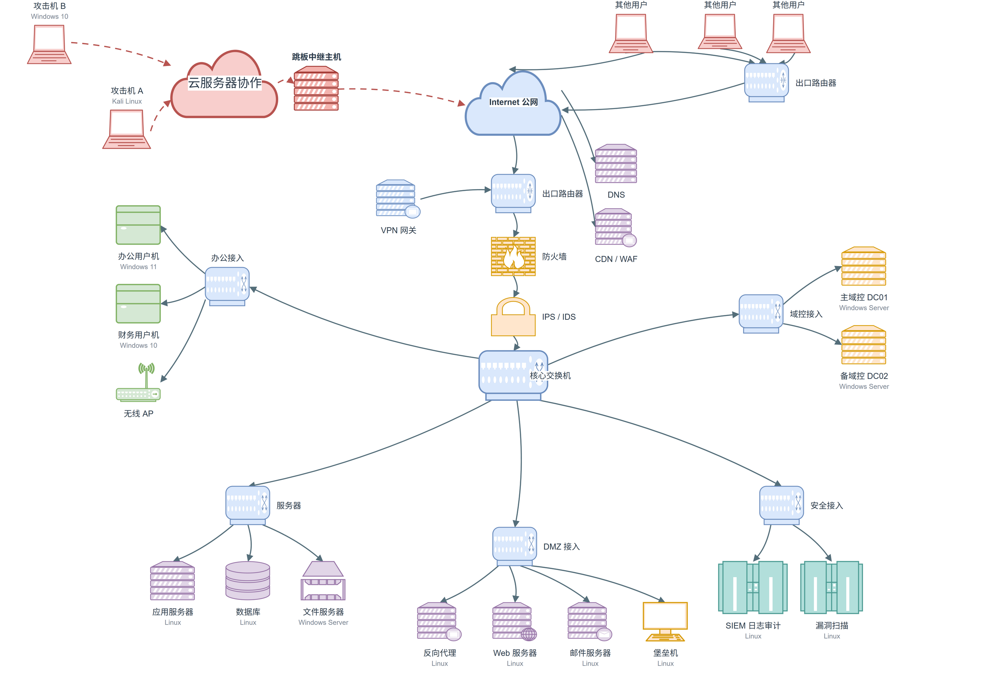

AI-Agent 渗透让传统手工渗透显得岌岌可危，但出路可能不在更卷的 Web，而在硬件、固件、工控、车联网与物联网。
<!-- more -->

上一篇文档随意聊天，聊到了关于AI-Agent渗透在网络安全中的介入能力，那时候我提到，或许我们一切走的太急，还没来得及把工具层模糊掉，就着急进入全自动渗透阶段。

昨天晚上，我在准备给新生的第一次 web 安全培训文档。一个星期前，为了介绍第一节培训內容，我反复调教了 dsh 生成一张「传统网络攻击拓扑图 」用于讲解传统人工渗透过程中的经典路径，也就是下面这张图。

其实这张图是一张比较经典的，甚至已经可以算得上现代而成熟的攻击链路，不过不够极度前沿，那么为什么说是「传统 」呢？

最开始我的设想是，这里还没有引入 Agent 对于安全行业的致命打击。AI渗透、AI挖洞、AI审计、AI逆向（如REA）基本宣告了 Agent 开始在传统渗透与安全领域全面占领。是的，我最开始只是单纯认为，Agent 颠覆了传统渗透测试，我们所有搞手工渗透的，尤其是像我这样还没学明白，实战能力还差的一塌糊涂的人。既不懂手动渗透，又不懂Agent渗透和挖洞，在这样内卷的环境下，肯定要死翘翘了。本来做完这张拓扑图后，想到这里，我是很绝望的。

周四的早上，我在继续阅读HackTheBox的文章，里面我又发现了很多原来忽略了的內容，我把他们的链接一个个慢慢记录到自己的 draft.md（草稿）里，资源一点一点累积。碰见一些没见过的资源，我让 dsh 去帮我搜索一下这个 web 包含了什么资源。

因为涉及社团活动而感到自恋，我自己还挺喜欢这套社团活动的培训体系。portswigger 2 modules/week，推进，做实验，给出前置阅读材料，和拓展阅读材料。这时候我去和网页版 AI chat，聊自己的体系我还挺喜欢的，稍微弥补了之前碰到的其他培训课程的问题：

1. 看课自己会困 
2. 时间太长 
3. 几乎没有可实现的作业，要么难的离谱，学完一点Python语法就让你做个抢票脚本，要么就没有作业，几乎得不到实践练习，最后上完人还是很差 
4. 课程质量层次不齐，查找困难 
5. 受到不能“打自己脸”的限制，培训机构不会推荐其他优质的培训平台 
6. 不仅是不能打脸，设计上也没准备全面的丰富资料，让学生自己搜，但是学生搜不到，特别是在还没有AI-Agent聚合搜索的时候 
7. 过于顺应国内的实战派思路，讲解非常野，没有体系化，技能全在讲师的嘴巴里，不在文档里。而自己听课又听不懂，自己只有看文档能学懂。

和AI聊着聊着，他说出来 pwn.college 这个网站，我去搜索和查看了这个网站，发现內容质量高的出奇。再继续聊着，AI又给我爆出来了 OST2 这个资源库。

时间回到大一第二学期，那时我坐在学校书店，有个类似咖啡店或者酒馆那样的高桌台，看《分子生物学》还有各种各样的內容。那时候，我从 Deepseek 口中问出来了，我购买的这个课程的內容教学速度快的过分，同时深度又浅地过分，毫无疑问，在培训角度上我吃了一次大亏。但 Deepseek，或者说 AI Agent 是一个强力的搜索引擎的概念，已经进入了我的脑海。那时候的人们，有不少都是这样使用AI的，随口一问随眼一看，非常方便，我们不再看百度了。不过因为缺少web_search，RAG等能力，彼时AI的搜索正确率还堪忧，大量大量的幻觉其实让你不能分清真真假假。我从AI口中问出了很多资料，例如 OSTEP、CSAPP。我还不知道，这些东西撑起了计算机科学的半壁江山。我只是觉得，我被坑了，那么我该何去何从，我没找到答案，接下来也不记得自己干了什么，慢慢悠悠地过去了。

所以，回旋镖再次回击我。十月十七日，deepseek 官方发布了 V4.1Flash-1017模型，并且新增了 web_search 接口，也差不多正是从暑假开始，我才开始中度使用 Agent。到上面，可能这件事情非常简单，简单的可笑：我再次回到了「搜索引擎 」的怀抱，但这次不一样了。

从 deepseek v4.1 Flash 第一版发布开始，我在使用体验上就感到，ds的搜索正确率在不断上升。暑期我搜索HTB题解，使用V4 Flash，还经常发现错误。然而到 V 4.1 Flash时，从前经常出现的搜索歌词错误，现在已经全部正确，web数据的搜集正确率也逐渐提高。我是从每次网页 chat 的搜集结果，那些 12 个 14 个 web pages 中发现这个事情的，我还特别问过  AI：AI 聚合搜索好强，如果我自己来搜，不知道能不能搜到这些东西呢。AI 说是的，人类的搜索和 AI 的批量关键词检索抓取，在准确度和效率上，是冷兵器对热武器，完全没有胜算。注意，这时候我用的还甚至只是 web chat，不是 Agent。

回到Agent，从 Deepseek V4.1 Flash 1017 的 web_search 发布那天，一直到我发现 pwn.college 的这天，我反应过来了。互联网这座大冰山，我只看到了一角的一角。在前AI时代，我可能这辈子啊，也就死在这了，永远没法突破桎梏，永远不懂 search，碰见问题永远不会搜集答案。但是 Agent 聚合搜索来了，一切都不一样了。如果你自己用过 Agent 的聚合搜索，甚至开 subAgent 搜索和整合，你可以理解我惊叹的是什么意思，Agent 的强大比普通网页 chat 强出不知道多少。多轮搜索，自我检测，质量检查，把结果质量提高了不知道多少倍。聚合搜索，可以突破我原本未知的领域，让我知道自己有哪些不知道。

在此之外，强大的不是聚合搜索这一点小事，而是从这一件事情上我开始发现，Agent 的自动化比我们想象中的还要强大。可以说，Agent 的能力取决于你的对数字生活的想象力，你觉得哪些事情可以被你更加全面而高级地自动化？这是认识层面上的完全不同。

回到传统渗透，我觉得我完蛋了。想到我是从电子信息「逃跑」而来的网络安全，心生绝望。大一时，我不懂是什么是计算机体系，不懂C，C++，被硬件调试折磨得体无完肤，我习得性无助而害怕，得了硬件PTSD，我逃跑。这个晚上我又问自己，其实还不算质问，只是思考怎么向新生介绍什么是传统安全，如果这是传统安全，那么什么是非传统安全？难道非只有Agent渗透吗？不对，这个时候我自己发现不对，我漏了太多东西。你也知道，这个答案几乎是所有人都能脱口而出：物联网安全（IoT）、车联网安全、工控（ICS）、固件安全（HardWare）都是。这就是我原本没有注意到的那部分非传统安全。

Agent 的聚合搜索，可能是一项不太一样路标，那个一个瞬间，我突然意识到了自己需要做什么：我要回头。如果传统安全卷的不成样子了，并且现在AI又大热，AI-Agent安全也是众矢之的，所有人都抢着上的。像我这种智力残疾级别的人，还是别想着和人家啊硬碰硬了。那么，我既然是电子信息本科出身的，那么，为什么不考虑硬件安全、固件安全、工控安全、车联网安全、物联网安全呢？

站在大三的视角上回看，我已经没那么害怕硬件了，只是积重难返。如果要转到以上说的哪些防线，可是资料又基本没有，这是僵局，对吗？

不对，我不知道固件安全要学哪些东西，不知道资源有哪些，可以怎么学，任何关于这方面安全的事情我都不了解，我不知道我不知道。那么，Agent 聚合搜索，就是利用批量搜索而强行打破这个局面，探测未知的工具。

使用Deepseek 15 块钱 token，我暂时性的探测了一遍上面的內容，可谓收获颇丰。我大概整理一遍，我想，我已经知道自己的方向往哪走了。我已经不害怕硬件了，资源，Agent帮我解决了。在这一年的时间里，很多人对于 Agent 的理解还没有跟上，对于生活的方方面面，都没有意识到这些问题，这是一种新的生产力工具，绝对不是简单的自然语言驱动的简易自动化。在这条路上，我们还有很长路要走。

硬件安全绝对不简单，但人少恰好可以补足这一点。资源缺乏与门槛高导致了解的人少，了解的人少，迭代速度稍慢。而资源缺乏实际上不是完全缺乏，而是我们不知道自己不知道，找不到可供学习的材料，但Agent又补齐了这点。当我看见一个模块搜集出的结果全是英文资料，没有任何中文资料时，我知道，方向肯定对了，现在就出发吧。